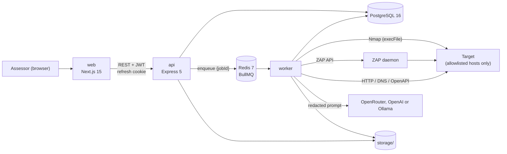
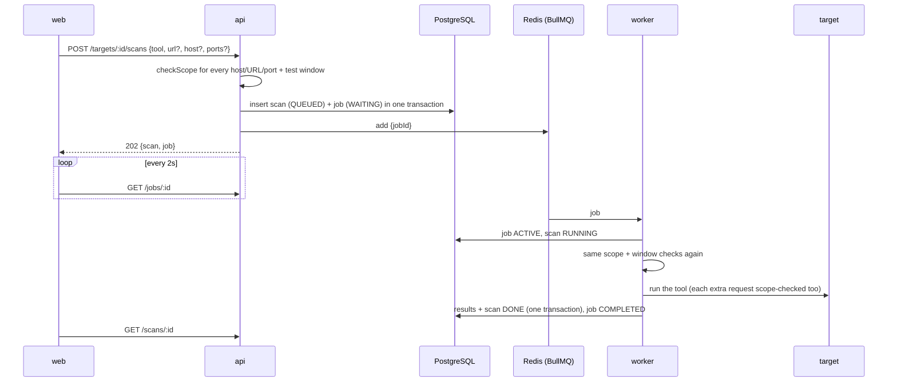

# Architecture

Tanaw is a separate platform that assesses one authorized web application (Bayaw Jobs). It runs security tools, imports
their reports, asks an AI to interpret results and draft fixes, and keeps a human assessor in charge of what counts as a
confirmed vulnerability. Setup is in [setup.md](setup.md); the tables are in [schema.md](schema.md).

## 1. Components



| Component | Folder | Job |
|---|---|---|
| web | `apps/web` | Assessor UI: targets, scope, scans, findings, verification, AI drafts, dashboard, report (PDF via print) |
| api | `apps/api` | REST API under `/api`: auth, roles, scope checks, imports, findings, verification, dashboard, report; queues work |
| worker | `apps/worker` | Runs queued jobs: HTTP check, DNS, OpenAPI, Nmap, ZAP, and the two AI features |
| shared | `packages/shared` | One source of truth: enums, Zod schemas, `checkScope`, CVSS; `@tanaw/shared/node` has parsers, `redact()`, storage |
| PostgreSQL | Docker | All data ([schema.md](schema.md)) |
| Redis | Docker | Job queue (`tanaw-assessment`) |
| ZAP | Docker | OWASP ZAP daemon, reachable only from the worker |
| storage | `storage/` (volume) | Raw tool output, imported reports, evidence files |

## 2. Request chain (API)

```
authenticate → requireRole → validate (Zod) → [aiDailyLimit] → controller → service → repository → Prisma
```

- **Controllers** are thin: parse input, call one service, send `{ success, message?, data, errors?, meta? }`.
- **Services** hold the rules (scope, status machine, AI checks). **Repositories** hold every Prisma query.
- **Errors** are `AppError` subclasses turned into JSON by one error middleware: `400` validation, `401`, `403` (role
  or out of scope), `404`, `409`, `413`, `429` (rate limit, lockout, AI cap), `503` (queue down, AI not configured).
- Roles: **ADMIN** (everything, users, audit log), **ASSESSOR** (targets, scans, findings, verification),
  **VIEWER** (read-only, including the report).

Folder map (`apps/api/src`): `config/` env, logger, Prisma, storage · `routes/` one router per resource ·
`middlewares/` auth, validate, rate limits, upload, AI cap, errors · `controllers/` · `services/` · `repositories/` ·
`queues/` BullMQ producer · `utils/` responses, errors, crypto, JWT · `scripts/` seed, schema docs.

## 3. Assessment workflow

The demo follows NIST SP 800-115: **Define scope → Reconnaissance → Scanning → Security assessment → AI analysis →
Findings verification → Risk assessment → Report**.

| Step | Where in Tanaw |
|---|---|
| Define scope | Register the target (allowlisted host only), add HOST / URL / PORT_RANGE rules, optional test window |
| Reconnaissance | DNS lookup, OpenAPI endpoint list, Nmap service detection |
| Scanning | HTTP security check, OWASP ZAP spider + passive scan, or import Nmap/ZAP reports |
| Security assessment | Manual WSTG tests for the 3 categories, recorded as manual findings with evidence |
| AI analysis | "Interpret with AI" on a scan (feature 1), "Suggest fix" on a finding (feature 2) |
| Verification | An assessor confirms, rejects or marks false positive, with notes and evidence |
| Risk assessment | Final severity + CVSS v3.1 (Tanaw computes the score from the vector), OWASP Top 10, WSTG ID |
| Report | Confirmed and fixed findings only, with evidence, history, remediation; export to PDF |

## 4. Job flow



Tool jobs run once (a second scan is noise on the target). AI jobs retry once on provider errors or malformed replies.
If Redis is down the API answers `503` and marks the scan and job FAILED instead of leaving them queued forever.

## 5. Tools

| Tool | How | Results |
|---|---|---|
| HTTP check | `fetch` without following redirects, 15 s timeout: 8 security headers, disclosure headers, cookie flags (never values), CORS probe with a foreign Origin, HTTP→HTTPS redirect (only if plain HTTP is in scope) | HEADER, COOKIE, CORS, REDIRECT |
| DNS | `node:dns/promises`: A, AAAA, CNAME, MX, TXT, NS, CAA | DNS_RECORD |
| OpenAPI | Fetches the spec, lists method, path, auth requirement, admin routes | ENDPOINT |
| Nmap | `execFile` with `-sV -T3 -Pn --max-retries 2 -p <ports> -oX - -- <host>`; host and ports validated first; max 1024 ports | PORT, SERVICE |
| ZAP | Daemon API, one run at a time: new session, context limited to the scan URL, spider (context + subtree only), wait for passive scanning, Traditional JSON report, keep only in-scope instances, redact | ALERT |
| Imports | Nmap XML or ZAP JSON upload (≤ 5 MB). Every host, port and ZAP instance URI must be in scope or nothing is stored | as above |

No tool attacks the target: Nmap runs no scripts, ZAP's active scan is off unless `ZAP_ACTIVE_SCAN_ENABLED=true`
(instructor approval only).

## 6. AI pipeline

Two features, both through `askJson()` in `apps/worker/src/ai/provider.ts`:

1. **Interpreting scan results:** numbered results (`r1…rN`, max 150) → findings `{title, category, affected_asset,
   explanation, evidence_refs, suggested_severity, owasp_top10, wstg_id}`. Saved as **PENDING** findings with the cited
   results as evidence (made-up refs are dropped).
2. **Suggesting remediation:** one finding + up to 8 evidence items + trusted stack facts → a **draft**
   `{summary, steps, code_example, references, confidence}`. Nothing changes until an assessor accepts or edits it.

Every call: `redact()` → cap at `AI_MAX_INPUT_CHARS` → SHA-256 of what is sent → wrap in `<tool_output>` (with any such
tags removed from the data) → OpenRouter or OpenAI Structured Outputs (strict JSON schema), or Ollama → Zod validation →
stored in `ai_analyses`. Prompts are in `apps/worker/src/ai/prompts/` (owned by the AI integration role).

The provider, model and API key are chosen by an admin on the Settings page, not in `.env`. The key is write-only: the
API encrypts it with AES-256-GCM under a key derived by scrypt from `SETTINGS_ENCRYPTION_KEY` (fresh salt and IV per
save, authenticated data bound to the setting) and stores only the ciphertext and the last 4 characters. The worker
decrypts it per job. No endpoint returns it, and the audit log records only that it changed.

| OWASP Top 10 for LLM Applications 2025 | Control in Tanaw |
|---|---|
| LLM01 Prompt injection | Untrusted data wrapped in `<tool_output>`, tags stripped from it, prompts say to ignore instructions inside; the AI has no tools and can only return JSON |
| LLM02 Sensitive information disclosure | `redact()` removes JWTs, auth/cookie headers, passwords, API keys, emails, PH phone numbers before sending; the provider key itself is stored encrypted and never returned |
| LLM05 Improper output handling | Strict JSON schema + Zod; output stored as data, rendered as text, never executed |
| LLM06 Excessive agency | The AI can't change anything: findings stay PENDING, fixes stay drafts |
| LLM09 Misinformation | Human verification is required; the report only shows confirmed findings |
| LLM10 Unbounded consumption | Per-user daily cap (`429`), input cap, 60 s timeout, one retry |

## 7. Security controls

| Area | Control |
|---|---|
| Scope | `checkScope` (allowlist → out-of-scope rules → target host → port ranges → URL prefixes) runs in the API when queueing and in the worker when running, on every report host, every extra request and every ZAP URL. Blocks are `403` + `scope_blocked` audit rows. Test windows are enforced. |
| SSRF | Only exact allowlisted hostnames can be contacted; no redirects followed; URLs with credentials refused |
| Auth | bcrypt passwords, 15-min JWT access token held in memory, httpOnly `SameSite=Strict` refresh cookie scoped to `/api/auth`, rotation with reuse detection, lockout after 5 failures (a wrong current password on password change counts too), per-IP login rate limit, users re-checked on every request; changing the password revokes every session |
| Access control | Role checks on every route; admins can't remove themselves or the last admin |
| Input | Zod on every body, query and param; uploads size-limited and typed by their bytes |
| Shell | Nmap via `execFile` with an argument array; host/port regexes; `--` before the host |
| Secrets & data | Only `.env.example` in git; secrets validated at startup (production rejects examples); logs scrub secret-looking keys; evidence and ZAP output redacted before storage |
| Headers | Helmet on the API, strict security headers on the web, evidence files served with `nosniff` and a sandbox CSP |
| Audit | Logins (success, failure, lockout), token reuse, user changes, targets, scope rules, scope blocks, scans, imports, AI requests, findings, verifications, remediation, evidence, report exports |
| Human in the loop | Only `PATCH /findings/:id/verify` changes status; confirming needs severity, CVSS and evidence |

## 8. Decisions

See [adr/](adr/). The main one: [0001: Tanaw is a separate platform](adr/0001-separate-platform.md).
